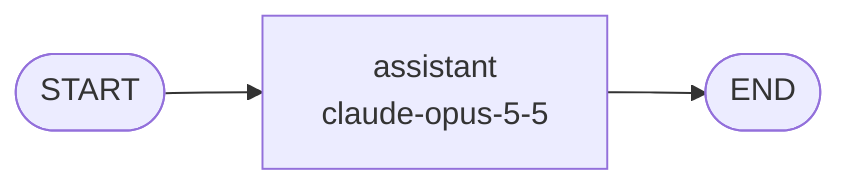

# card-help

LangGraph agent.

Built with Agent Builder. This folder is configuration only: [`agent.yaml`](agent.yaml) says how
the agent behaves, and `prompts/` hold its text.
agent-builder-runtime >=1.0,<2 builds the LangGraph graph from it and serves it, so there is
no generated Python to review.

To change the agent, open it in Agent Builder (Import, then choose this folder as a zip), or edit
the files by hand. After a hand edit to a prompt or skill, run `agent-builder lock` to record the
new hashes, then `agent-builder check`. The runtime refuses to start if a file no longer matches
its hash.

## Graph



| Node | Type | Provider | Model | Settings | Prompt |
|---|---|---|---|---|---|
| `assistant` | llm | Anthropic | `claude-opus-5-5` | max_tokens=16000 | `prompts/assistant.md` |

Each run is capped at 25 graph steps, so a loop cannot run forever.

## Run as a container

The image builds on `agent-builder-runtime:1.0.0` and serves a REST endpoint and
the A2A protocol on port 8080. The build runs `agent-builder check` and `agent-builder test`, so an
invalid folder never becomes an image.

```bash
cp .env.example .env   # then fill in the values
docker build -t card-help .
docker run --rm -p 8080:8080 --env-file .env card-help
```

The server does not authenticate callers. That is the API gateway's job, so only expose
the container through the gateway.

## Run locally

```bash
python -m venv .venv && source .venv/bin/activate
pip install "agent-builder-runtime>=1.0,<2"
agent-builder check          # validate agent.yaml and its files
agent-builder test           # contract tests, no API calls
agent-builder serve          # REST and A2A on http://localhost:8080
```

Interactive API docs are at http://localhost:8080/docs. From Python, the nodes are async:

```python
import asyncio

from agent_builder_runtime.graph import build_graph
from agent_builder_runtime.loader import load_agent

graph = build_graph(load_agent("."))
result = asyncio.run(graph.ainvoke({"messages": [{"role": "user", "content": "Hello"}]}))
print(result["messages"][-1].content)
```

### REST

The server keeps no history between calls, so send the whole conversation each time.

```bash
curl -s http://localhost:8080/invoke \
  -H "Content-Type: application/json" \
  -d '{"messages": [{"role": "user", "content": "Hello"}]}'
```

```json
{"reply": "...", "routes": {}, "skills_used": [], "tools_used": []}
```

`routes` shows the label each router node picked, which helps when testing routing.
`skills_used` lists the skills in the prompts of the nodes that ran, with the hash of
each skill file, so every reply can be traced to the exact instructions it used.
`tools_used` lists the tool calls the run made, in order.

### A2A

Other agents discover this one from its agent card, then call the JSON-RPC endpoint.

| Path | Purpose |
|---|---|
| `GET /.well-known/agent-card.json` | Agent card. Advertises `PUBLIC_URL/a2a`. |
| `POST /a2a` | A2A 1.0 JSON-RPC: `SendMessage`, `GetTask`, `ListTasks` |

Each A2A message is answered on its own: earlier messages in the same context are not
sent to the graph. Task state is held in memory, so it is lost on restart and not shared
between replicas.

LangGraph Server can also serve the graph, from `langgraph.json`, once agent-builder-runtime
is installed.

## Environment variables

| Name | Purpose |
|---|---|
| `ANTHROPIC_API_KEY` | Anthropic API key |
| `PUBLIC_URL` | Address published in the A2A agent card. Default `http://localhost:8080` |
| `AGENT_VERSION` | Version published in the agent card. Default `1.0.0` |
